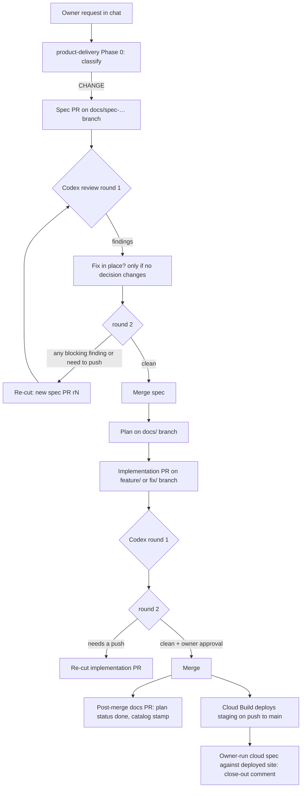

# Harness engineering and PR orchestration audit

**Date:** 2026-11-02 · **Repositories:** TeneikaAskew/stocks, TeneikaAskew/solyra, TeneikaAskew/insights-collective
**Mode:** read-only discovery. No code, workflow, branch, PR, deployment or production data was changed to produce this document.
**Reference:** the Harness Engineering Blueprint (2026-11-02) was used as a design vocabulary, not as evidence of repository state.

Every claim below is tagged **CONFIRMED** (observed in a file, a commit, a PR event, a workflow run, or a live GCP read, with the locator) or **HYPOTHESIS** (plausible, not verified here, with the check that would verify it).

---

## 0. Summary

The three repositories do not suffer from a missing harness. stocks and solyra carry one of the most elaborate agent harnesses this auditor has seen in a two-repo project: persistent task identity (FEAT-IDs), a spec-before-code gate enforced in a pre-commit hook and in CI, plans bound to branches, a two-round review cap, a four-pass judgment budget per lineage, a one-writer rule, evidence requirements with screenshots, and an auditable product catalog. Almost every item on the Blueprint's checklist already exists in prose.

The dysfunction comes from the shape of that harness, not its absence:

1. **The harness is enforced by prose and by agents reading prose, not by mechanisms.** Review budgets, lineage ledgers, owner approvals and "reservations" live in PR comments and PR bodies written by the agent. The agents spend a large share of each session maintaining this bookkeeping, and the bookkeeping itself triggers CI (see finding F3).
2. **The gate makes new PRs the only legal repair path.** The spec gate, the immutability rules (a superseded spec may not change, an approved spec changes only through a superseding spec, a plan is one branch, no push after review round two) and the review cap combine so that most corrections cannot land on the branch that needs them. The system then mints a replacement PR. The replacement is a design consequence, not an agent error (F1, F2).
3. **The harness has become the main product.** In October, 177 of 229 stocks PRs (77%) came from `docs/` branches, 46 PRs since 1 September carry FEAT-CICD-001 in their title, 13 of 69 open PRs are about the gate itself, and the gate's own code and tests (about 55,000 lines in stocks) are larger than `lib/` (36,000) or `platform/api` (32,000). The gate's test suite is now too slow for the CI job that runs it, which produced three spec PRs and two re-cuts about the timeout (F4).
4. **The required external reviewer has run out of credit.** Codex's usage limit was hit on 23 stocks PRs since 1 October. Because the process requires a Codex "Completed" row on the current head before merge, every merge since then has needed a hand-relayed owner exception written into the PR (F5).
5. **Two ungated writers push to `main` in the Lovable-connected repos.** Lovable's bot (`gpt-engineer-app[bot]`) made 106 direct commits to solyra `main` and 191 to insights-collective `main` in 90 days, bypassing the spec gate, the pre-commit hook and review. One of those commits broke CI for every open solyra PR on 2026-10-30 and cost an extra PR (F6).
6. **Issue creation outruns delivery by about 2:1 in stocks and is unbounded in solyra.** Audit sweeps file issues in batches (84 on 2026-10-07 alone); 154 solyra issues were opened since 1 October and none closed (F7).
7. **Deployment is already automated and currently in sync** (Cloud Build trigger on push to `main`, last deploy 2026-10-30, no undeployed change in the trigger's paths as of this audit), but the process treats a merge as a deployment decision needing separate owner authorization, which holds merges that are otherwise done (F8).

The recommended direction is subtraction, then mechanisation: remove the prose-enforced loops that generate PRs, replace the few that matter with deterministic state the repository holds, and redirect the agents' effort from ledgers to runtime evidence. Section 6 gives a dependency-ordered backlog; section 7 proposes a pilot on one real feature with baseline numbers taken in section 3.

---

## 1. Current-state architecture (verified)

### 1.1 Who initiates work, writes branches, opens PRs, reviews

| Actor | stocks | solyra | insights-collective | Evidence |
|---|---|---|---|---|
| Owner (TeneikaAskew) in Claude Code sessions (cloud, Cowork, CLI) | Author of every PR and every non-bot commit | Same | Same, plus 100 commits authored "Claude" on `main` in 90 days | `git log` authors; all 69 open stocks PRs by the owner account; PR bodies carry `claude.ai/code/session_…` links |
| An external multi-session coordinator ("project coordinator", "external root assistant", assistants named `Sentinel_<hex>`) | Relays owner decisions into PR bodies as quoted chat text; grants "exceptions" | Same | Not observed | stocks #1690 body, #1642 comments 6561757545, 6567399038 (CONFIRMED that such a layer exists; its implementation is outside the repositories and was not inspected) |
| Codex (`chatgpt-codex-connector[bot]`) | Required code review and security review on every PR head; out of credit since late October | Same | Comments on 7 PRs since September, not required | Codex summary comments on #1642, #1689, solyra #308; search count 23 PRs with "reached your Codex usage limits" |
| Lovable (`gpt-engineer-app[bot]`) | none | 106 direct commits to `main` in 90 days (730 `src/` file touches, 36 `.github/`, 276 `.claude/`) | 191 direct commits to `main` in 90 days | `git log --author=gpt-engineer`; solyra commit `18806e3` adds `.claude/agents/*` and `.claude/settings.json` |
| GitHub Actions `handle-workflow-failure` | Opens issues and draft PRs on workflow failure (`create_pr: true` on the monthly doc refresh) | none | none | stocks #1662 "FEAT-CICD-001: Monthly architecture doc refresh failed" (auto PR); `.github/workflows/handle-workflow-failure.yml` |
| GCP `failure_notifier` | Opens `[ESCALATED] GCP job failed:` issues | none | none | issues #1688, #1646, #1560 |
| Cloud Build triggers | `deploy-solyra-api-staging` on push to `main` touching `platform/**`, `lib/**`, `requirements.txt`, `gcp/database.py`; `apply-schema-on-change` on `gcp/schema.sql` | Lovable publish (HYPOTHESIS: manual) | Supabase migrations via `db-migrate.yml` dispatch | `gcloud builds triggers list --region=global`; solyra has no deploy workflow |

Reviewers cannot create implementation PRs: Codex only posts reviews and comments; the Claude reviewer prompts (`.claude/agents/*-reviewer.md`) are read-only tool sets. **CONFIRMED.** The replacement PRs are created by the implementing session itself, under the rules in 1.3.

### 1.2 Harness surface per repository

| Surface | stocks | solyra | insights-collective |
|---|---|---|---|
| Root instructions | `CLAUDE.md` 2,102 lines (108 KB); `AGENTS.md` 83 lines | `CLAUDE.md` 544 lines; `AGENTS.md` 168 lines (contains the four-pass review budget) | `CLAUDE.md` 275 lines; a second `.claude/claude.md`; 23 status/summary `.md` files at repo root (6,899 lines) |
| Claude Code hooks (`.claude/settings.json`) | One `UserPromptSubmit` hook: injects "reconcile against live state" when a webhook event arrives | Same | None; `settings.local.json` sets `bypassPermissions` with deny rules for force-push and hard reset |
| Skills | 17 vendored Superpowers skills + `product-delivery` (111 lines, including a 2,500-word "committed-source documentation identity" protocol) | Same set, `product-delivery` 88 lines | None |
| Subagents | 19 (`code-reviewer`, `fallback-guard`, `gcp-*`, `replay-integrity-reviewer`, …) | 9 | 9 (`architect`, `migration-planner`, …) |
| Commands | `audit-review`, `commit`, `debug-workflow`, `gcp-deploy`, `resolve-issue` (1,132 lines), `validate-data` | `commit`, `resolve-issue` | `audit-review`, `commit-auto`, `debug-analyze`, `playwright-test`, `test-run` |
| Memory | none in repo (ledgers live in PR comments) | none | `.claude/memory/01…08-*.md` lessons files |
| Git hooks | `.githooks/pre-commit` → `scripts/gate/spec_gate.py --commit` | Same | None |
| Gate code | `spec_gate.py` 4,825 lines; `docs_audit.py` 8,215; `doc_inventory.py` 4,460; `doc_source_snapshot.py` 1,063; tests 32,377 lines under `tests/scripts/` | `spec_gate.py` 4,136 lines; `docs-audit.mjs` | `scripts/audit/*` (query inventory, route reachability, types drift, fixtures) |
| CI workflows | `spec-gate` (pull_request_target: opened, synchronize, reopened, **edited**, ready_for_review; two required jobs), `registry-check` (6-minute cap, runs the gate's own 178-test suite), `Backtest Pipeline` (24-minute test suite on every PR, no path filter on `pull_request`), `deploy-staging` (manual), `refresh-architecture-docs` (monthly, 1,145 lines, opens a PR), `rerun-transient-doc-refresh` (workflow_run), `verify-docs-against-live`, `update-superpowers`, `gh-api` bridge | `spec-gate`, `registry-check`, `CI` (types/unit/build, no path filter), `E2E` (paths-ignore docs), `update-superpowers`, `gh-api` | `pr-checks`, `test` (CI/CD Pipeline), `security` (CodeQL, TruffleHog, licence), `nightly`, `e2e` (workflow_dispatch only, not on PR), `db-migrate` (dispatch) |
| Product record | `docs/product/00…16` (21,852 lines); 74 specs (52 approved, 15 superseded), 34 plans (12 ready, 9 done) | `docs/product/`, 21 specs, 16 plans | `.lovable/plan/*.md`, root status files |

### 1.3 The delivery loop as implemented (stocks and solyra)

Minimum PR count per change: three (spec, implementation, post-merge close-out), plus one spec per re-cut. In the 100 most recently closed stocks PRs, 81 heads were `docs/` branches and 69 titles mention a spec. **CONFIRMED.**

The loop has budgets in prose: two review rounds (CLAUDE.md line 10), four judgment passes per lineage (solyra AGENTS.md "Review budget and finding identity"), a bar on pushing after round two (stocks CLAUDE.md lines 341-344). There is no mechanical counter: the count is maintained by the agent in PR comments ("aggregate7 / CODE6", "LOCAL-1689-SPEC2 (slot 2 of 2, no third)").

### 1.4 insights-collective delivery loop

No spec gate, no FEAT-IDs, no issues (0 open, 0 closed). Work is tracked in PR titles ("T-09", "WP-09A", "r4"), in `.lovable/plan/*.md`, and in root-level status files. Since 1 September: 28 PRs, 9 merged, 19 open and all drafts, 27 of 28 from `claude/` branches, 6 titled "UNRUN", 3 titled "stacked". 109 of 116 remote branches are `claude/*`. 85 commits since 1 October reached `main` without a PR (Lovable and direct pushes). E2E runs only on manual dispatch. **CONFIRMED.**

---

## 2. Findings (root causes), with evidence

### F1. The immutability rules force corrections into new PRs — CONFIRMED

The gate refuses, on the same branch: changing a spec once `main` holds it as approved (product-delivery Phase 2), changing a superseded spec ("a superseded spec does not change"), a plan that points at a superseded spec, a PR that adds its own catalog row or approves its own spec. The review cap adds: after round two nothing is pushed, "a PR that then needs either is split, re-cut or discarded" (stocks CLAUDE.md 341-344).

Worked example, stocks #1689 → #1690 (2026-11-02): #1689 flipped the 2026-10-13 verifier spec to `superseded` in the same PR. CI went red because `tests/scripts/test_doc_source_snapshot.py` builds fixtures from that spec's live bytes (148 of 199 tests fail). The fix (do not flip the old spec) was refused by the pre-commit hook on the branch. The agent cut #1690 from `main`, merged it 55 minutes later, and #1689 is still open. Three Codex runs, nine gate runs and two 5-minute base-suite runs were spent on a one-number change (8 MiB → 12 MiB). Source: #1689 comments 6579677367; #1690 body "Why a re-cut".

Lineage counts in the sample: stocks closed PRs since 10-13 contain 9 explicit re-cuts/replacements; solyra closed PRs since 09-06 contain 22 (verify-email spec r2 → r6, review-guidelines spec r2 → r4 plus implementation r2 → r3, freshness carryover r2 → r5, confirm-on-return r2 → r5 where "r3 and r4 were written and pre-reviewed but never opened").

### F2. Specs have inflated past what the change needs — CONFIRMED

solyra #278 (open since 2026-10-12): the spec for an email-verification banner is at revision 5, carries 23 `done_when` items, 15 E2E tests, and 50 named screenshots. stocks #1690: a spec-only PR for one constant has an 11-item `done_when` list and a 2,000-word body. The product-delivery skill requires `done_when` items copied as checkboxes into the PR body, and the gate refuses a ticked box whose line defers work, so the spec's size directly sets the implementation PR's merge bar.

### F3. The agents' own bookkeeping triggers CI; CI runs are five to nine per PR head — CONFIRMED

`spec-gate.yml` fires on `pull_request_target` type `edited`. Agents edit PR bodies to maintain the ledger, so one head gets several gate runs: in a 14-hour window, 52 spec-gate runs covered 14 branches (9, 7, 5, 5, 4, 4, 4 …), with five runs on the identical sha `cdaff37` (#1690) and four on `6989acc` (#1693). Each run also starts a `base-suite` job of about five minutes. `Backtest Pipeline` (24 minutes, "Run Tests" 18:20 → 18:44 on #1693) runs on every PR regardless of paths; #1693 is a docs-only PR. stocks shows 7,453 workflow runs in total; the sampled rate is about 170 runs per day, solyra about 125 per day.

### F4. The gate generates its own work — CONFIRMED

- `registry-check` runs the gate's own test suite under a 6-minute job cap; the suite now takes 308 to 350 seconds plus setup, so the job is cancelled on unrelated PRs (#1642 comment 6567626458, #1608 the same). This produced spec #1678, its replacement #1683 (merged), the pin-stage PR #1693 and #1692 (open), and issue #1684.
- 13 of 69 open stocks PRs and 46 of 399 PRs since 1 September are FEAT-CICD-001. Open issues #1684, #1669, #1668, #1665, #1542, #1511, #1510, #1445, #1438, #1428, #1414, #1388, #1372 are about the gate, the review rules or carrying "nonblocking findings" from one spec PR into the next.
- The product-delivery skill's "Committed-source documentation identity (FEAT-CICD-001)" section (about 2,500 words) describes a snapshot/verifier protocol with bootstrap routes, sidecars and retirement sequencing. The current-trunk mechanism for "documentation says what the code does" has become a multi-PR protocol with its own spec lineage (#1689/#1690, #1644, #1630, #1595, #1581, #1569, #1590).
- Volume: gate, maintenance scripts and their tests total about 55,000 lines in stocks, against 36,000 in `lib/` and 32,000 in `platform/api`.

### F5. The required reviewer is unavailable and the process has no fallback — CONFIRMED

CLAUDE.md requires a Codex Code Review row reading Completed for the head sha before merge. Codex replied "You have reached your Codex usage limits" on 23 stocks PRs since 1 October (one in solyra). Since then merges have used owner exceptions relayed through chat and recorded in PR comments ("Per the owner's 14:05:49Z reply, this qualified independent review replaces the unavailable Codex review"), or "LOCAL-…-SPEC1/2" qualification passes run by the same account that wrote the change. 12 open PRs created since 10-25 carry "owner" and "exception" in their body. The process's independence guarantee is currently nominal.

### F6. Lovable is an ungated, concurrent writer to `main` — CONFIRMED

solyra: 106 Lovable commits to `main` in 90 days ("Changes", "Work in progress", "Lovable update"), 74 of them on 2026-10-12. The spec gate runs only on `pull_request_target`, and the pre-commit hook does not run for Lovable, so these commits are never gated. On 2026-10-30 commit `d9c2dd2` added three devDependencies to `package.json` and `bun.lock` without updating `package-lock.json`; `npm ci` then failed for every open PR, and #309 ("chore(deps): synchronize npm lock with Lovable dependencies") was needed before #308 could merge (solyra #308 comment 6521113072). Lovable also committed `.claude/agents/*`, `.claude/settings.json` and `.github/` files (`18806e3`), so harness files have a second writer. insights-collective: 191 Lovable commits in 90 days. The product-delivery skill's "Never let a second agent (Codex, Lovable, …) push to a branch this plan owns" is a prose rule without an enforcement point.

### F7. Issue intake outruns delivery — CONFIRMED

| | Opened | Closed |
|---|---|---|
| stocks, August | 145 | 49 |
| stocks, October | 187 | 92 |
| solyra, since 1 October | 154 | 0 |

84 stocks issues were filed on 2026-10-07 alone (`[P2][Help] …`, `[P3][Journal] …`), from an audit sweep. The catalog lists 45 open `[P1]` and 12 `[P0]` issues in stocks. The `resolve-issue` command is 1,132 lines and runs a seven-phase procedure per issue. Monitoring loops (the audit sweeps, `failure_notifier`, `handle-workflow-failure`) produce findings faster than the delivery loop can retire them.

### F8. Deployment is automated and in sync, but the process treats merge as a deploy decision — CONFIRMED

Live reads on 2026-11-02: trigger `deploy-solyra-api-staging` fires on push to `main` for `platform/**`, `lib/**`, `requirements.txt`, `gcp/database.py`; builds succeeded on 10-27, 10-29, 10-30 (sha `d447843` last). `git diff d447843..HEAD` over those paths is empty, so staging serves current `main`. Three builds failed on 10-24 and 11-01 (tag `trigger-5d1b5b91…`, the schema trigger: HYPOTHESIS, not opened). Yet #1642's merge was held "for a decision on whether that deploy is authorized" (comment 6567507778) after two clean Codex reviews and green CI, because the owner's "Yes" was scoped to "source merge only". Merge-equals-deploy is the actual pipeline; the process asks for two approvals for one event.

solyra has no deploy workflow; the site is published by Lovable from `main`. Whether that publish is automatic on push is a HYPOTHESIS (check: Lovable project settings, or compare the served `assets/index-*.js` hash with a local build of `main`).

### F9. State and handoff live in chat and PR comments, not in the repository — CONFIRMED

No task-state artifact exists (`docs/agent-state/`, a task JSON, a tracker). The lineage ledger ("aggregate3 / CODE2 plus SEC", "slot 2 of 2") is prose in PR comments; owner approvals are chat quotes with timestamps pasted into PR bodies (#1690 "User Sentinel_6701c098… answered 'Yes'"). A new session must reconstruct budget state by reading every comment on every PR in the lineage. The Blueprint's reconciliation rule ("reconcile agent memory with repository truth") is impossible when the truth is itself a transcript.

### F10. The parallel-session fan-out produces bursts of PRs — CONFIRMED (mechanism HYPOTHESIS)

28 stocks PRs were created on 2026-10-13 and 28 solyra PRs on 2026-10-11; 14 on 2026-10-25. Most are spec-only PRs for distinct FEAT-IDs opened within minutes (#1518 … #1529 between 23:05 and 00:42). Of the 23 closed-unmerged stocks PRs in the sample, 20 are spec PRs that were replaced the same day. The coordinator layer (F9) fans work out across sessions per FEAT; each session follows product-delivery to the letter and opens its spec PR. The mechanism (how many concurrent sessions, how they are assigned) is outside the repos and was not inspected.

### F11. insights-collective has the opposite problem: no gate, no state, stacked unrun work — CONFIRMED

19 open drafts in 48 hours, six marked "UNRUN", three "stacked"; E2E does not run on PRs; no issues; 85 ungated commits to `main` since 1 October; root directory holds 23 status files. The `.claude/memory/08-checks-that-check-nothing.md` lesson file records "a typecheck that checked zero files, tests that passed whether the feature worked or not". There is no mechanism that ties a PR to an acceptance journey.

### F12. Hooks do not cause recursion — CONFIRMED (negative finding)

The only Claude Code hook in stocks/solyra is a `UserPromptSubmit` context injector. `rerun-transient-doc-refresh` re-runs only `run_attempt == 1` failures of one workflow. `handle-workflow-failure` deduplicates by label and head-branch prefix. The recursion-like load (F3) comes from the `edited` trigger and unfiltered test workflows, not from hooks.

---

## 3. Baseline measurements (for the pilot in section 7)

| Metric | stocks | solyra | insights-collective | Source |
|---|---|---|---|---|
| PRs created, Aug / Sep / Oct | 52 / 137 / 229 | — / 132 since 1 Sep | — / 28 since 1 Sep | `search/issues` |
| Merge ratio, Aug / Sep / Oct | 90% / 88% / 45% | 73% since 1 Sep | 32% since 1 Sep | same |
| `docs/` heads, Oct | 177 of 229 (77%) | 60 of 132 (45%) | 0 | same |
| Open PRs (drafts) | 69 (42) | 7 (3) | 19 (19) | same |
| Median hours to merge, p90 (sampled) | 6.5, 94 | 0.6, 30 | — | PR list sample |
| Re-cut or replacement PRs in sample | 9 of 100 | 22 of 100 | — | title and head patterns |
| FEAT-CICD-001 PRs since 1 Sep | 46 of 399 | 8 of 100 sampled | n/a | search |
| Codex usage-limit refusals since 1 Oct | 23 PRs | 1 | n/a | search |
| Workflow runs per day (sampled) | ~170 | ~125 | — | `actions_list` |
| Gate runs on one identical head | up to 5 | — | — | `actions_list` |
| Remote branches | 735 (234 `docs/`, 126 `claude/`) | 136 | 116 (109 `claude/`) | `ls-remote` |
| Open issues; opened/closed Oct | 244; 187/92 | 162; 154/0 | 0 | search |
| Lovable commits to `main`, 90 days | 0 | 106 | 191 | `git log` |
| Gate + maintenance + tests (lines) | ~55,000 | ~4,300 gate only | ~ (audit scripts) | `wc` |
| Staging deployed sha vs `main` on trigger paths | in sync (`d447843`) | unverified | n/a | `gcloud` |

---

## 4. PR inventory and disposition recommendations

Dispositions are recommendations for the owner; none was executed. "Close" means close unmerged and keep the branch until the roadmap item that replaces the content lands.

### 4.1 stocks (69 open)

| Class | PRs | Disposition |
|---|---|---|
| **Ready to merge** | #1642 (ORB, FEAT-PLAYBOOK-001: two clean Codex code reviews and two clean security reviews on the reviewed bytes, green CI except the unrelated registry cancellation) | Merge; let the trigger deploy; run the solyra counterpart (#310) as the pilot (section 7). |
| **Superseded, still open** | #1689 (replaced by merged #1690), #1678 (by merged #1683), #1649 (by #1677), #1663 (by merged #1664), one of #1660 / #1679 (same subject), #1437 (older Superpowers bump than #1615), one of #1566 / #1575 (STRAT spec r2 / r3) | Close with a one-line comment naming the successor. |
| **Gate self-work (FEAT-CICD-001)** | #1693, #1692, #1691, #1680, #1679 or #1660, #1644, #1630, #1595, #1585, #1583, #1579, #1598, #1569, #1590, #1581, #1426 | Freeze. Do not open more until roadmap items H1 to H4 land; then re-evaluate each against the simplified gate. Most become unnecessary (the registry timeout, the retry-split substitution, the verifier bounds). |
| **Spec-only PRs with no implementation started, 2 to 3 weeks old** | #1424, #1425, #1442, #1443, #1490, #1518, #1520, #1521, #1522, #1523, #1524, #1525, #1526, #1527, #1528, #1529, #1567, #1580, #1645, #1685, #1686, #1687, #1677 | Keep at most one approved spec per FEAT-ID that has an implementer assigned this month; close the rest to issues (one issue per spec, body = spec summary). A spec with no implementation window is a backlog item, not a PR. |
| **Implementation drafts older than two weeks** | #1384, #1430, #1448, #1478, #1489, #1495, #1546, #1564, #1608 | Owner picks at most three to finish (suggested: #1546 shared market calendar, #1608 event-bound reactions, #1564 intraday incident). Close the AV series (#1430, #1448, #1478, #1489, #1495) to issues unless an implementer is assigned. |
| **Active implementation drafts** | #1643, #1658, #1659, #1670, #1671, #1681 | Keep; land in dependency order (EarningsWhispers retirement chain #1658 → #1659 → #1681). |
| **Auto-created failure PR** | #1662 | Close; keep issue #1661. Set `create_pr: false` on the doc-refresh handler (H5). |
| **Small docs** | #1673, #1647, #1584, #1503 (non-conforming `claude/` branch; retitle or close) | Merge or close within a day. |
| **Vendored skills bump** | #1615 | Merge if the suite passes; it is a `bot/` branch the gate allows. |

### 4.2 solyra (7 open)

| PR | State | Disposition |
|---|---|---|
| #314 FEAT-AUTH-001 client state per account | draft, 11-01 | Keep; it is the implementation of the spec that took five revisions. Land under the pilot rules. |
| #311 FEAT-INSIGHT-001 source clocks | draft, depends on stocks #1645 (spec, open) | Hold until the stocks spec is decided; otherwise close to an issue. |
| #310 FEAT-PLAYBOOK-001 consume current-session ORB | draft, depends on stocks #1642 | Pilot PR: merge after #1642 deploys and the cloud spec passes. |
| #297 FEAT-UI-001 redesign spec | ready, 10-28 | Owner decision: approve or close. A redesign spec with no implementer is a roadmap item. |
| #289 FEAT-CATALYST-001 earnings UI | ready, 10-26 | Review state unknown; if Codex is unavailable, apply the interim review rule (H6) and merge or close. |
| #285 weekly freshness audit 10-19 | ready, 10-19 | Merge or close; it is two weeks stale. |
| #278 confirm-on-return spec r5 | ready, 10-12 | Close; #314 already implements the account-transition behaviour. If the banner is still wanted, re-scope to five `done_when` items. |

### 4.3 insights-collective (19 open, all drafts)

All were opened 2026-10-31 to 11-02 from `claude/` branches, six "UNRUN", three stacked. Recommendation: no new PRs until these are dispositioned. Merge order by dependency: #134 (WP-00 baseline and E2E guard) → #140 (T-09 harness) → #143 (db-migrate atomic apply; #144 already merged the stacked part, so #143 may be redundant) → #156 (gradebook journey job) → the `fix(...)` PRs (#139, #141, #142, #147, #149) each only after its journey test runs green in CI → the `test(...)` proposals (#148, #150, #152, #153, #155, #161) merge only with a run that executed them. #145, #146 (features) wait for the journey harness. #154 (ownership record) and #157 (bounded public-catalog job) are process; fold into the roadmap.

---

## 5. Target harness design (minimal, evidence-driven)

The design keeps what works (FEAT-IDs, the catalog, the no-silent-fallback rule, hermetic E2E, Cloud Build on `main`, failure notifier) and replaces prose loops with four mechanisms. Nothing here adds an agent, a loop or a rule without removing a larger one.

### 5.1 Persistent task identity and work state (replaces PR-comment ledgers)

- One file per task: `docs/tasks/<FEAT-ID>-<slug>.yml` with `task_id`, `goal`, `acceptance` (3 to 7 items), `owner_session`, `branch`, `pr`, `status` (`READY`, `IMPLEMENTING`, `VERIFYING`, `REVIEW`, `BLOCKED`, `MERGED`, `DEPLOYED`, `VERIFIED_LIVE`), `review_rounds` (integer), `evidence` (list of `{kind, ref, sha, at}`), `blocker`.
- The gate validates the file's shape and that `branch` and `pr` are unique across tasks (idempotent PR: a second task file naming the same branch is refused). This replaces the plan-per-branch rule, the ledger comments and the "reservation" prose.
- The spec document becomes optional context attached to the task, not a gated artifact. A task file is the unit the gate reads.

### 5.2 Dependency-aware orchestration without new agents

- `depends_on: [task_id or repo#PR]` in the task file. A task whose dependency is not `MERGED` cannot move to `REVIEW`. Cross-repo dependencies (solyra #310 on stocks #1642) become visible and mechanical.
- The coordinator layer (F10) assigns one task per session and records `owner_session` in the file. A session that finds a task owned by a live session returns a finding, not a PR.

### 5.3 Bounded loops, mechanically counted

- `review_rounds` is incremented by a tiny workflow step when a reviewer review is submitted on a new head, not by the agent. At 2 the gate blocks further pushes **only if a P0/P1 thread is open**; otherwise pushes continue and merge happens at green. This removes the "must re-cut to push" rule that produces F1.
- Specs and superseded specs are editable on their own branch. Immutability is replaced by history: `git log` is the record. The "a superseded spec does not change" refusal goes.
- Repair budget: a CI failure on the PR's own code is repairable in place, any number of pushes; the budget that matters is the review budget above.

### 5.4 Safe, deterministic lifecycle hooks (Claude Code)

- `PreToolUse` on `Bash`: deny `gh pr create` and `git push` to a branch when the task file names a different open PR, or when no task file names the current branch. Deny `git push` to `main`. This is the only new hook. It is a script with tests, not a prompt.
- `Stop`: refuse completion when the task file's `status` is `VERIFYING` or `REVIEW` and `evidence` lacks the kinds the acceptance items name (unit, api, e2e, deployed). Honour `stop_hook_active`.
- `SessionStart`: print the task file for the current branch and the PR's check state. Nothing else.
- Keep the existing `UserPromptSubmit` webhook reconciler.

### 5.5 Skills and instructions, trimmed

- `CLAUDE.md` in stocks shrinks to the stable facts (architecture map, commands, the no-silent-fallback rule, sandbox network notes) and points at `docs/` for incident history. Target under 400 lines. Rules 2.5's Codex-row procedure, the four-pass budget text, and the committed-source identity protocol move out of the loaded instruction set.
- `product-delivery` becomes: classify (TRIVIAL / CHANGE), open or resume the task file, implement, verify with the acceptance kinds, update the task file, open or update the one PR.
- Reviewer agents stay read-only. The `resolve-issue` command shrinks to the task-file flow.

### 5.6 Independent verification with runtime evidence

- Keep the hermetic E2E suite as the PR gate for solyra. Add the `*.cloud.spec.ts` project as a **post-deploy** job that an Actions workflow runs against staging with a stored service account session, writing screenshots to the task's evidence list. The owner-run interactive sign-in step is the reason no cloud spec has ever executed (docs/E2E_TEST_PLAN.md "deployed execution unexecuted"); replace it with a non-interactive test identity.
- stocks: `deploy-staging` Cloud Build already runs on `main`; add a post-deploy smoke job (health, `/api/me`, one endpoint per changed router) that posts its result to the task file via a bot commit on a `docs/` branch, or to a check run.
- `VERIFIED_LIVE` is set only by that job. An agent cannot set it.

### 5.7 Idempotent PR creation and branch reuse

- `ensure_pr(task_id)`: a script (`scripts/harness/ensure_pr.py`) that finds the open PR for the task's branch and returns it, or creates one. All agent prompts call it; the `PreToolUse` hook refuses direct `gh pr create`.
- Branch reuse: a failed CI or a review finding updates the existing branch. Re-cutting is allowed only when the owner closes the PR.

### 5.8 Merge, deploy and security gates

- Required checks on `main`: `spec-gate / gate` (task-file validation), `CI`, `E2E` (solyra), `Run Tests` (stocks, path-filtered). `registry-check` runs only when `scripts/gate/**` or `docs/product/07-*` change.
- Review: Codex when available; when Codex reports a usage limit, the check marks "reviewer unavailable" and the owner's GitHub approval is the review. No chat-relayed exceptions.
- Deploy: merge to `main` is the deploy authorization (it already is). Schema changes keep `apply_schema` opt-in.
- Security: CodeQL on PR for all three repos (insights-collective already has it).

### 5.9 Telemetry: delivery, not activity

Computed weekly by one script from the GitHub API and the task files, committed to `docs/metrics/harness-weekly.md`:

task-to-PR ratio, PRs per merged task, re-cut count, median hours open-to-merge, review rounds per merged PR, percentage of merged tasks with `VERIFIED_LIVE`, issues opened vs closed, workflow runs per merged PR, Codex refusals, direct commits to `main` by non-PR writers.

---

## 6. Implementation roadmap (dependency-ordered backlog)

Risk: **L** reversible by revert, **M** changes CI behaviour, **H** changes who can write where. Each item is one PR.

| # | Item | Depends on | Risk | Files | Acceptance | Tests | Rollback | Expected benefit |
|---|---|---|---|---|---|---|---|---|
| H1 | Stop running the gate on PR body edits: drop `edited` from `spec-gate.yml` types in both repos; validate the PR body in the `ready_for_review` and `synchronize` events only | — | M (pinned copy under `scripts/gate/pinned/` must change first, per the two-PR rule) | `.github/workflows/spec-gate.yml`, `scripts/gate/pinned/spec-gate.yml` | Gate runs per head sha ≤ 2 over a week | Workflow lint; one PR with three body edits shows one run | Revert the two commits | About 40% fewer runs (F3) |
| H2 | Path filters on test workflows: `Backtest Pipeline` `pull_request` gets the same `paths` as its `push`; solyra `CI` gets `paths-ignore` for `docs/**` and `*.md` like `E2E` | — | L | `backtest-pipeline.yml`, solyra `ci.yml` | A docs-only PR runs no 24-minute suite | Open a docs-only PR; observe | Revert | 20+ runner-minutes per docs PR |
| H3 | Raise the `registry-check` cap to 10 minutes and run it only when `scripts/gate/**`, `tests/scripts/**`, `docs/product/07-*` or `docs/EXPERIMENT_REGISTRY.md` change | H1 (pinned-copy rule) | M | `registry-check.yml` and pinned copy | No cancelled registry job in a week | Observe | Revert | Removes F4's red-on-unrelated-PR; closes #1678/#1683/#1693 lineage |
| H4 | Interim review rule: when Codex posts a usage-limit comment, the owner's GitHub review approval satisfies the review requirement; record it in CLAUDE.md Rule 2.5 and AGENTS.md; delete the chat-exception procedure | — | L | `CLAUDE.md`, `AGENTS.md` (both repos) | No PR body quotes a chat approval after the change | n/a (docs) | Revert | Ends F5's hand-relayed exceptions |
| H5 | `handle-workflow-failure`: `create_pr: false` for the doc refresh; failures become issues only | — | L | `refresh-architecture-docs.yml` | No auto PR on next failure | Dispatch dry run | Revert | One fewer auto PR class |
| H6 | Lovable writer isolation (solyra, insights-collective): connect Lovable to a `lovable` branch instead of `main`; a scheduled workflow opens one PR from `lovable` to `main` when it diverges; `package-lock.json` sync runs in that workflow | — | H (changes the connected branch; coordinate with Lovable settings; never rewrite history) | Lovable project setting; new `.github/workflows/lovable-sync.yml` | Zero `gpt-engineer-app[bot]` commits on `main` for two weeks; PR CI never breaks on lockfile drift | Sync workflow runs on a test divergence | Reconnect Lovable to `main` | Ends F6 |
| H7 | Task file format and validator: `docs/tasks/*.yml`, schema, `scripts/harness/task.py` (`new`, `set-status`, `add-evidence`, `check`), gate reads it in addition to the plan for a transition period | — | L | new files; `spec_gate.py` (small addition) | `task check` passes on three migrated lineages (#1642/#310, #314, #1546) | Unit tests for the validator | Delete files | Foundation for 5.1 |
| H8 | `ensure_pr` script and `PreToolUse` hook that refuses `gh pr create` and `git push` when no task file names the branch, and `git push` to `main` | H7 | M | `scripts/harness/ensure_pr.py`, `.claude/hooks/guard-pr-create.py`, `.claude/settings.json` | A second PR for an existing task branch is refused with a message naming the open PR | Hook unit tests with stdin JSON; manual run | Remove the hook entry | Ends duplicate PRs per task |
| H9 | Mechanical review-round counter: a workflow step that increments `review_rounds` in the task file (bot commit on the PR branch) on each reviewer review of a new head; gate blocks a push at ≥ 2 only when a P0/P1 thread is open | H7 | M | new workflow, `spec_gate.py` | `review_rounds` matches GitHub review count on three PRs | Workflow test on a fixture PR | Revert; counter is advisory | Replaces prose budgets (F1, F9) |
| H10 | Remove the immutability refusals from the gate: superseded spec edits, approved-spec edits on their own `docs/` branch, "plan points at superseded spec"; keep "a PR cannot approve its own spec" | H7, H9 | M | `spec_gate.py`, `tests/scripts/test_spec_gate.py` | #1689-style failure is fixable on the same branch | Existing suite minus the removed cases; add a same-branch repair case | Revert | Ends F1 |
| H11 | Trim instructions: stocks `CLAUDE.md` to < 400 lines, move incident narratives to `docs/incidents/`; `product-delivery` to the task-file flow; drop the committed-source identity protocol from the loaded skill (keep it as a design note in `docs/`) | H7 | L | `CLAUDE.md`, `.claude/skills/product-delivery/SKILL.md` | Loaded instruction tokens per session cut by half (measure with `wc -c`) | Docs audit unchanged | Revert | Cheaper, less contradictory sessions |
| H12 | Non-interactive cloud E2E: a test identity in Firebase, a stored session artifact, `e2e-cloud.yml` on `workflow_run` of the staging deploy (or on a schedule) running `*.cloud.spec.ts` and uploading screenshots; the job writes `VERIFIED_LIVE` evidence | H7 | M (test identity must be scoped read-only) | solyra `tests/**/*.cloud.spec.ts`, new workflow, stocks Cloud Build notification or a scheduled trigger | The ORB pilot's cloud spec runs green on staging without a human | The spec itself | Disable the workflow | First real deployed-state evidence (F8) |
| H13 | Post-deploy smoke job in stocks Cloud Build (health, `/api/me`, changed routers) with a check-run result | — | L | `gcp/cloudbuild/deploy-solyra-api-staging-cloudbuild.yaml` | Smoke step visible on the build | Run against the current revision | Remove step | Deploy evidence |
| H14 | Weekly harness metrics script and `docs/metrics/harness-weekly.md` | H7 | L | `scripts/harness/metrics.py`, scheduled workflow | First report equals the section 3 baseline within tolerance | Script tests on fixture JSON | Remove | Measures the pilot |
| H15 | insights-collective: run `e2e.yml` on `pull_request` for the journey specs that exist; add a task file per open draft; close or merge the 19 drafts in the order in 4.3 | H7 (format shared) | M | `.github/workflows/e2e.yml` | Open drafts ≤ 5 and each has a green journey run | Workflow run | Revert trigger | Ends F11 |
| H16 | Issue intake bound: audit sweeps file one tracking issue per surface with a checklist, not one issue per finding; `resolve-issue` works a checklist | — | L | `.claude/commands/audit-review.md`, `resolve-issue.md` | Opened/closed ratio ≤ 1.2 over a month | n/a | Revert | Ends F7 growth |

Items H1, H2, H4, H5 and H16 can start the same day and need no new infrastructure. H6 needs the owner to change the Lovable connection. H7 to H10 are the harness core and should land in order. H12 and H13 are the verification layer and can proceed in parallel with H8 to H10.

Things the roadmap deliberately does not do: add agent teams, add a planner agent, add a `Stop` hook that keeps the agent working, add more reviewers, or port the stocks gate to insights-collective as it stands.

---

## 7. Proposed pilot

**Task:** FEAT-PLAYBOOK-001 current-session opening range (ORB). It already has a reviewed implementation (stocks #1642), a dependent frontend PR (solyra #310), an auto-deploy path, and a user-visible outcome ("ORB conditions go dark after 11:38 ET", issue #1304).

**Steps**

1. Create `docs/tasks/FEAT-PLAYBOOK-001-current-orb.yml` for the pair (H7 format, hand-written if H7 has not landed), with `depends_on: stocks#1642` on the solyra side and five acceptance items: API test passes; staging serves the new response (smoke); hermetic E2E passes on #310; cloud spec shows the ORB panel populated after 11:38 ET on staging with screenshots; issue #1304 closed with the evidence links.
2. Merge #1642 under H4's interim review rule. Let the trigger deploy. Record the build id and revision in the task file.
3. Run the solyra cloud spec against staging (H12 manual run is acceptable for the pilot). Record screenshots.
4. Merge #310. Confirm the Lovable publish serves it (compare asset hash). Record.
5. Close #1304 from the task file's evidence.

**Baseline vs pilot measurements** (section 3 values are the baseline):

| Metric | Baseline | Pilot target |
|---|---|---|
| PRs per delivered task | 3+ (spec, impl, close-out) plus re-cuts | 2 (one per repo) |
| Workflow runs per merged PR | 5 to 9 gate runs plus 24-minute suite | ≤ 3 |
| Review rounds | 2 per PR, counted by hand | counted by H9 or by GitHub review count |
| Time from merge to `VERIFIED_LIVE` | never recorded (no cloud spec has run) | < 24 hours |
| Chat-relayed exceptions in PR body | 1 or more | 0 |
| Issue closed with runtime evidence | 0 for this feature | 1 (#1304) |

**Rollback:** the pilot adds one YAML file per repo and closes one issue; nothing else changes. If the cloud spec cannot be made non-interactive within the pilot, record `BLOCKED` with the reason and keep the owner-run step, which is the current state.

---

## 8. Hypotheses not verified here, and how to verify them

| Hypothesis | Check |
|---|---|
| Lovable publishes solyra `main` automatically on push | Lovable project settings; or compare served `assets/index-*.js` hash with a local `npm run build` of `main` |
| Branch protection on `main` requires `spec-gate / gate`, `base-suite`, `registry` and conversation resolution | Dispatch `gh-api.yml` with `repos/{owner}/{repo}/branches/main/protection` (read-only) |
| The two failed Cloud Build runs on 2026-11-01 are the `apply-schema-on-change` trigger | `gcloud builds describe <id> --region=global` |
| The coordinator fans out one session per FEAT-ID and the sessions open spec PRs independently | Inspect the coordinator's configuration (outside these repositories) |
| Codex credit will be restored | Owner's Codex dashboard; until then H4 applies |
| The `[ESCALATED] GCP job failed` issues (#1688, #1646) are duplicates of a single root cause | `gcp-job-doctor` on the two executions |

---

## Appendix A. Evidence locators

- stocks #1689 comments 6578506051, 6579293522, 6579298122, 6579677367; #1690 body; #1642 comments 6516255527 … 6567626458; #1693 check runs (4 × gate, 4 × base-suite, Run Tests 18:20 → 18:44); solyra #308 comments 6520986102 … 6522230544; solyra #278 body.
- `stocks/.github/workflows/spec-gate.yml` lines 21-24; `registry-check.yml` line 25 and 99; `backtest-pipeline.yml` lines 11-36; `refresh-architecture-docs.yml` line 1145; `handle-workflow-failure.yml`.
- `stocks/CLAUDE.md` line 10 and lines 341-344; `stocks/.claude/skills/product-delivery/SKILL.md`; `solyra/AGENTS.md` "Review budget and finding identity".
- `git log --author=gpt-engineer` in solyra and insights-collective; solyra commit `18806e3`, `d9c2dd2`.
- `gcloud builds triggers list --region=global`, `gcloud builds list --region=global --limit=15`, `gcloud run revisions list --service=solyra-api-staging`, `git diff --stat d447843..HEAD -- platform lib requirements.txt gcp/database.py` (empty).
- GitHub search counts in section 3, run on 2026-11-02 with `gh api search/issues`.
