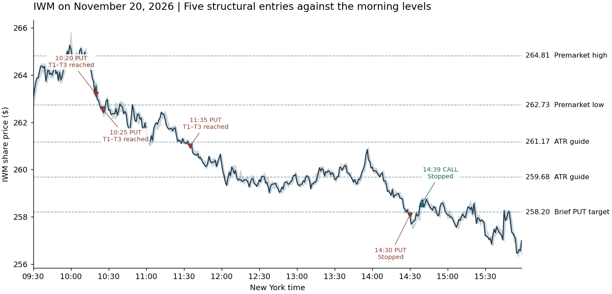

# Intraday brief and signal review for IWM, QQQ and SPY

**Question for the second reviewer.** When the market reaches a price named before the open, can a completed break or reclaim identify the next reachable structural or ATR level soon enough to matter? How much of that movement is available from an actual entry before its stop? This retrospective tests those questions on ETF share prices. It also examines what the live alert system recorded and what its daily allowance excluded.

**Most useful finding.** Updating the opening-boundary forecast after five completed minutes improved accuracy from **45/107 to 65/107** on the same eligible ETF-days. The lower and neither classes supplied the gain. Correct upper calls stayed at 16. The independent three-target results are much more uneven, especially on IWM and QQQ. A reviewer can evaluate the forecast and the entry rule separately. [Paired predictions](evidence/opening-forecast-pairs.csv) · [Frozen monitor results](evidence/08-monitor-holdout.json)

## What the experiments found

| Question | Result to check | Evidence |
|---|---|---|
| Does the two-sided brief anticipate price paths? | Reviews compared premarket high/low triggers, nearer structural levels, ATR spacing, first touch, close beyond, recross, return later and the opposite side. The six-month reversal study qualified 382 ETF-days. Its median favorable move from the open to the first defined five-minute reversal was 0.253 prior daily ATR. Other clocks and reversal definitions produce different distances. | [Experiment index, stages 1–7](EXPERIMENTS.md) |
| Can we update the forecast at 09:35? | January 2–August 31 supplied training. September 1–November 18 contributed 56 later sessions. Of 168 ETF-days, 59 had already hit a boundary and two lacked a bracket. The paired 107 unresolved cases spanned 50 sessions. Multiclass Brier error fell from 0.6371 to 0.5255. Thirty-two forecasts changed from wrong to right and 12 changed the other way. | [Opening outcomes](evidence/08-monitor-holdout.json) |
| Did additional indicators help? | On a separate 1,076-opportunity comparison the geometry-plus-indicator forecast was right on 914 versus 910 using geometry. Mean Brier improvement was 0.00034, interval −0.00184 to +0.00257. QQQ's point estimate worsened. The directions, time alignment and amount of room to the next rung deserve separate inspection for each ticker. | [Indicator comparison](evidence/11-forecast-scores.csv) · [Pine conditions at the target](evidence/10-at_target_summary.csv) |
| Do faster break notices help? | IWM later-period first-target hits were 157/459 for two-minute confirmation and 122/376 for five-minute confirmation, holding the stop lookback at five minutes. Tightening the two-minute variant's stop to two minutes reduced it to 123/459. Each clock selects its own events. | [Both clocks and stop widths](evidence/break-confirmation.csv) |
| What happens when strength filters precede the daily allowance? | Native policy A counts five attempts, including suppressed weak attempts. B counts the first five distinct medium-or-better episodes. C keeps all such episodes. Separate first-break notices use neither quota. Tests vary 1.2× or 1.5× five-minute volume and ETF return versus its two peers. Event counts, zero-risk exclusions and thin-stop sensitivity matter alongside hit rates. | [Native outcomes](evidence/native-policy-outcomes.csv) · [Volumes at admission](evidence/volume-admission.csv) |
| Do target and stop changes improve position returns? | In later serial trading, mapped thirds took IWM from +5.08R to −7.39R and SPY from +27.82R to +35.39R. QQQ's full T1 earned +14.33R versus +3.77R for the original rule, but its advantage reversed when the best date was removed. The earlier period also changed which rule led. | [Earlier/later and ticker comparison](evidence/15-profile-comparisons.csv) · [Stop experiments](evidence/13-Stop-policy-tests.csv) |
| How far did trades actually travel from entry? | Approach four measures three separate full exits from one entry and original stop. Later mean R per signal across the three alternatives was +0.079 IWM, +0.169 QQQ and +0.369 SPY. Median was −1R for each ticker. Earlier means were −0.019, −0.075 and +0.122 respectively. Right-tail winners dominate some of these averages. | [All four approaches](evidence/17-four-approach-comparison.csv) · [Booking and subsequent entries](evidence/booking.csv) |
| Can the proposed schedule preserve the data Insights read? | Local candidate controls covered an 08:45 internal brief, Insights dispatched from its committed edition, 09:15 public brief, 09:25 refresh and the 09:35 monitor update. The three delayed symbol workers each recovered the original internal edition. Queue and posting acknowledgments in that exercise were simulated. Natural cutover, image admission and delivery receipts remain open. | [Implementation and release status](IMPLEMENTATION.md) |

## Friday audit

On November 20, the issued IWM brief was bearish. Its downside trigger was 262.73 and its structural target was 258.20. Price opened at 263.32, swept the downside trigger, recrossed it and reached the original stop at 09:32. It crossed the upside trigger at 09:57 before turning lower. The actual monitor logged five PUTs by 09:39, suppressed four as weak and had one medium eligible for delivery. None reached the printed target within its posted 35 minutes. The eligible message has no verified Discord acknowledgment. [Issued text](evidence/friday-issued-brief.txt) · [Actual signal records](evidence/friday-original-alerts.csv)

The 09:25 reconstruction used the frozen research calibration and the last completed 09:24 bar. It agreed on both triggers. The 10:20, 10:25 and 11:35 downside entries each reached all three independent targets before their stops. The 14:30 PUT and 14:39 CALL both stopped. These five overlapping opportunities averaged +0.83R at T1, +0.98R at T2 and +2.41R at T3. A 1.2× hard volume floor would have excluded the 11:35 continuation, which reached the morning target at 14:26. The replay generated 13 first five-minute notices versus 33 when every recross rearmed the notice. [Every entry, risk distance, indicator, level and exit time](evidence/19-independent-entries.csv) · [First break notices](evidence/friday-break-notices.csv) · [Two-sided map](evidence/friday-map.jsonl)

## How to challenge the conclusions

1. Recompute the 107 paired forecasts. Count previously resolved or unbracketed cases separately. Compare classifiers on identical date, ticker, clock and destination. The later block had been inspected during other experiments, so it is retrospective.
2. Inspect one winner and one stop on the same ticker-day. Use the completed signal bar, next entry, original stop and the target still ahead at entry. On an ambiguous minute, give an intrabar stop precedence unless the open establishes an earlier exit. Mark a zero risk distance ungradable.
3. Compare positive target distance, target-hit credit, full-exit R and serial position totals. Show each denominator and rerun without the best session. Treat same-day signals across correlated ETFs and overlapping trades as dependent.
4. Compare each replay signal with an original event clock and strength where available. Distinguish calculated opportunity, notification eligibility, recorded suppression, and transport acknowledgment. Inspect wrong-side alerts and losses alongside missed continuations.
5. Review the ticker-specific settings frozen before the test block and whether the experiment could have accessed a future bar, updated daily close, later brief or corrected alert. Require timestamped forward observations before promoting a rule on the strength of these results.

Start with the [19-stage index](EXPERIMENTS.md), [scoring and reproducibility guide](METHODS.md), and [runtime candidate inventory](IMPLEMENTATION.md). The decisions requested here are which findings survive independent reproduction and which candidate warrants a prospective test.
